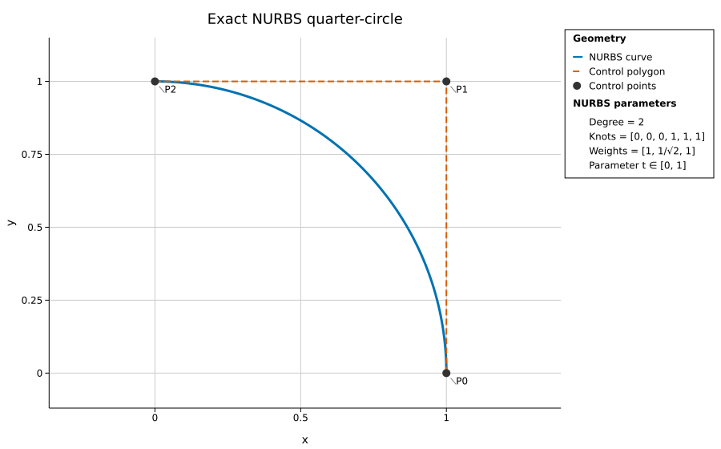

# bsfun

## Basis Spline Fun(ctions)

A small Rust library for learning and evaluating B-splines and NURBS
(Non-Uniform Rational B-Splines) in arbitrary dimension. The library has **zero
dependencies**. Kuva is a development dependency used only to draw the example
figure.

The API consists of five free functions and two owning structs:

- `bspline_basis()` evaluates a polynomial B-spline basis.
- `rational_bspline_basis_curve()` evaluates a weighted curve basis.
- `rational_bspline_basis_surface()` evaluates a weighted tensor-product surface basis.
- `nurbs_curve_point()` evaluates a curve point directly.
- `nurbs_surface_point()` evaluates a surface point directly.
- `nurbs::NURBSCurve` and `nurbs::NURBSSurface` provide `new()` and `eval()` with validation.

There are no fitting, derivative, knot-editing, meshing, or CAD operations.

## Example: an exact quarter-circle

```rust
use bsfun::nurbs::NURBSCurve;
use std::f64::consts::FRAC_1_SQRT_2;

let curve = NURBSCurve::new(
    2,
    vec![0.0, 0.0, 0.0, 1.0, 1.0, 1.0],
    vec![1.0, FRAC_1_SQRT_2, 1.0],
    vec![vec![1.0, 0.0], vec![1.0, 1.0], vec![0.0, 1.0]],
).unwrap();

let midpoint = curve.eval(0.5).unwrap();
assert!((midpoint[0] - FRAC_1_SQRT_2).abs() < 1e-14);
assert!((midpoint[1] - FRAC_1_SQRT_2).abs() < 1e-14);
assert_eq!(curve.eval(1.0).unwrap(), vec![0.0, 1.0]);
```



The middle control point `(1, 1)` has weight `1/√2`. These weights give the curve
`x² + y² = 1` between `(1, 0)` and `(0, 1)`. The dashed lines join the control
points; the curve does not pass through the middle control point.

Regenerate the plot with Kuva from the repository root:

```sh
cargo run --example nurbs_quarter_circle_plot
```

There are two evaluation paths within the existing API: the free functions
build on recursive `bspline_basis()` for a direct expression of the mathematics;
the structs' `.eval()` methods use a private iterative implementation that avoids
repeated recursive work. On the structs' valid domains, both paths compute the
same points up to floating-point rounding.

For surfaces, index `i` follows `u` and index `j` follows `v` in both
`control_points[i][j]` and `weights[i][j]`. Both grids must be rectangular. Points can have any
positive dimension; a surface point need not be three-dimensional.

## Visualization of B-spline basis functions

The degree-zero definition is

$$
B_{i,0}(t) = \begin{cases}
1 & \text{if } t_i \leq t < t_{i+1}, \\
0 & \text{otherwise}.
\end{cases}
$$

For degree $p > 0$, the Cox–de Boor recurrence is

$$
B_{i,p}(t) = \frac{t-t_i}{t_{i+p}-t_i}B_{i,p-1}(t)
          + \frac{t_{i+p+1}-t}{t_{i+p+1}-t_{i+1}}B_{i+1,p-1}(t).
$$

A term with a zero denominator contributes zero. The input conventions below
define the evaluation domain and its endpoint behavior.

The grid below uses the same interior knots `[1, 2, 3]` and domain `[0, 4]` for
every degree, with `p + 1` repeated knots at each end. Generated with
[Kuva](https://github.com/Psy-Fer/kuva):


Regenerate it from the repository root:

```sh
cargo run --example bspline_basis_plot
```

## Input and numerical conventions

A degree `p` spline with `n` control points needs `n + p + 1` knots, with
`0 <= p < n`. Knots must be finite and non-decreasing. A knot can occur at most
`p + 1` times. The structs evaluate on `[knots[p], knots[n]]`, and the interval
must have positive length. These rules apply to each direction of a surface.

At an interior knot, evaluation uses the right-hand value. At the domain's right
endpoint, it uses the left-hand limit. A clamped spline interpolates its first
and last control points if their weights are positive. An unclamped spline need
not pass through either endpoint control point.

Constructors reject empty or inconsistent data, non-finite coordinates, invalid
knot vectors, and negative or non-finite weights. At least one weight must be
positive. `eval()` rejects non-finite or out-of-domain parameters and returns
`Err` when the computed rational denominator is zero. Zero weights are allowed,
but can leave parts of the domain undefined.

The free functions assume valid data and may panic on malformed shapes or
indices. They evaluate over the full knot support, including outside the
structs' domains. They return zero for non-finite parameters, outside knot
support, or when the rational denominator is zero. Use the structs for input
and domain validation.

The free functions use recursive Cox-de Boor evaluation. Struct `.eval()` methods
compute the bases iteratively. Both paths compute the rational denominator once
per point. They scale weighted contributions and coordinates to reduce overflow
and underflow, and use compensated sums to retain small terms during
cancellation. Neither path uses an absolute epsilon cutoff for small weights or
knot spans. Extreme scales, cancellation, and tiny products of surface bases
can still lose precision in `f64`.

## Development

```sh
cargo test --all-targets
cargo test --doc
cargo clippy --all-targets -- -D warnings
cargo fmt --check
```

Tests compare recursive and iterative evaluations and cover analytic Bernstein bases, an exact rational circle arc, unequal-weight
surfaces, local support and partition of unity, repeated and unclamped knots,
endpoint behavior, extreme finite scales, and malformed construction inputs.

Licensed under MIT.
