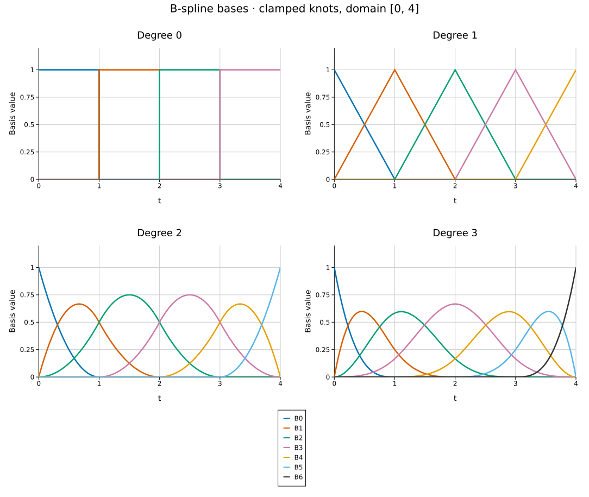

# bsfun

## Basis Spline Fun(ctions)

A small Rust library for learning and evaluating B-splines and NURBS
(Non-Uniform Rational B-Splines) in arbitrary dimension. The library has **zero
dependencies**. Kuva is a development dependency used only to draw the example
figure.

The API consists of five free functions and two owning structs:

- `bspline_basis()` evaluates a polynomial B-spline basis.
- `rational_bspline_basis_curve()` evaluates a weighted curve basis.
- `rational_bspline_basis_surface()` evaluates a weighted tensor-product surface basis.
- `nurbs_curve_point()` evaluates a curve point directly.
- `nurbs_surface_point()` evaluates a surface point directly.
- `nurbs::NURBSCurve` and `nurbs::NURBSSurface` provide `new()` and `eval()` with validation.

There are no fitting, derivative, knot-editing, meshing, or CAD operations.

## Example: an exact quarter-circle

```rust
use bsfun::nurbs::NURBSCurve;
use std::f64::consts::FRAC_1_SQRT_2;

let curve = NURBSCurve::new(
    2,
    vec![0.0, 0.0, 0.0, 1.0, 1.0, 1.0],
    vec![1.0, FRAC_1_SQRT_2, 1.0],
    vec![vec![1.0, 0.0], vec![1.0, 1.0], vec![0.0, 1.0]],
).unwrap();

let midpoint = curve.eval(0.5).unwrap();
assert!((midpoint[0] - FRAC_1_SQRT_2).abs() < 1e-14);
assert!((midpoint[1] - FRAC_1_SQRT_2).abs() < 1e-14);
assert_eq!(curve.eval(1.0).unwrap(), vec![0.0, 1.0]);
```

There are two evaluation paths within the existing API: the free functions
build on recursive `bspline_basis()` for a direct expression of the mathematics;
the structs' `.eval()` methods use a private iterative implementation that avoids
repeated recursive work. On the structs' valid domains, both paths compute the
same points up to floating-point rounding.

For surfaces, index `i` follows `u` and index `j` follows `v` in both
`control_points[i][j]` and `weights[i][j]`. Both grids must be rectangular. Points can have any
positive dimension; a surface point need not be three-dimensional.

## Input and numerical conventions

For **n control points** and **degree p**, there are **n + p + 1 knots**. The
knots are finite and non-decreasing, `p < n`, and no knot occurs more than
`p + 1` times. Degree zero is supported. The evaluation domain is the closed
interval **[knots[p], knots[n]]**, which must have positive length. Surfaces use
the same rules in each direction.

Interior knots use the right-hand value. The domain's right endpoint uses the
left-hand limit. Thus clamped splines with positive endpoint weights interpolate
their first and last control points, including at the right endpoint. Unclamped
splines use the same domain rule without assuming endpoint interpolation.

Constructors return `Err` for empty or inconsistent data, non-finite coordinates
or knots, invalid degrees or knot vectors, and negative or non-finite weights.
At least one weight must be positive. Individual zero weights are allowed;
`eval()` returns `Err` where the computed rational denominator is zero. It also
rejects non-finite parameters and parameters outside the evaluation domain.

The free functions assume the same valid input data and may panic on malformed
shapes or indices. Raw bases retain their full knot support, including outside
the structs' standard evaluation domain. The free point functions likewise leave
parameter range validation to the caller. They return zero outside knot support
(including non-finite parameters) or where the rational denominator is zero.
Use the structs for domain validation and errors on undefined evaluations.

The free basis and point functions use the recursive Cox–de Boor definition for
teaching. Struct `.eval()` methods use a private bottom-up helper to avoid
repeated recursive work. Both paths compute each point's rational
denominator once and scales weighted contributions and coordinates
to reduce overflow and underflow. Compensated sums retain small terms amid large
opposite coordinate contributions. There is no absolute epsilon threshold for
small weights or knot spans. Ordinary `f64` precision still limits very disparate
scales, cancellation, and tiny tensor-product bases; this is a teaching tool,
not an arbitrary-precision geometry kernel.

## Visualization of B-spline basis functions

The degree-zero definition is

$$
B_{i,0}(t) = \begin{cases}
1 & \text{if } t_i \leq t < t_{i+1}, \\
0 & \text{otherwise}.
\end{cases}
$$

For degree $p > 0$, the Cox–de Boor recurrence is

$$
B_{i,p}(t) = \frac{t-t_i}{t_{i+p}-t_i}B_{i,p-1}(t)
          + \frac{t_{i+p+1}-t}{t_{i+p+1}-t_{i+1}}B_{i+1,p-1}(t).
$$

A term with a zero denominator contributes zero. The domain and endpoint
conventions above apply to the final bases.

The grid below uses the same interior knots `[1, 2, 3]` and domain `[0, 4]` for
every degree, with `p + 1` repeated knots at each end. Generated with
[Kuva](https://github.com/Psy-Fer/kuva):



Regenerate it from the repository root:

```sh
cargo run --example bspline_basis_plot
```

## Development

```sh
cargo test --all-targets
cargo test --doc
cargo clippy --all-targets -- -D warnings
cargo fmt --check
```

Tests compare recursive and iterative evaluations and cover analytic Bernstein bases, an exact rational circle arc, unequal-weight
surfaces, local support and partition of unity, repeated and unclamped knots,
endpoint behavior, extreme finite scales, and malformed construction inputs.

Licensed under MIT.
